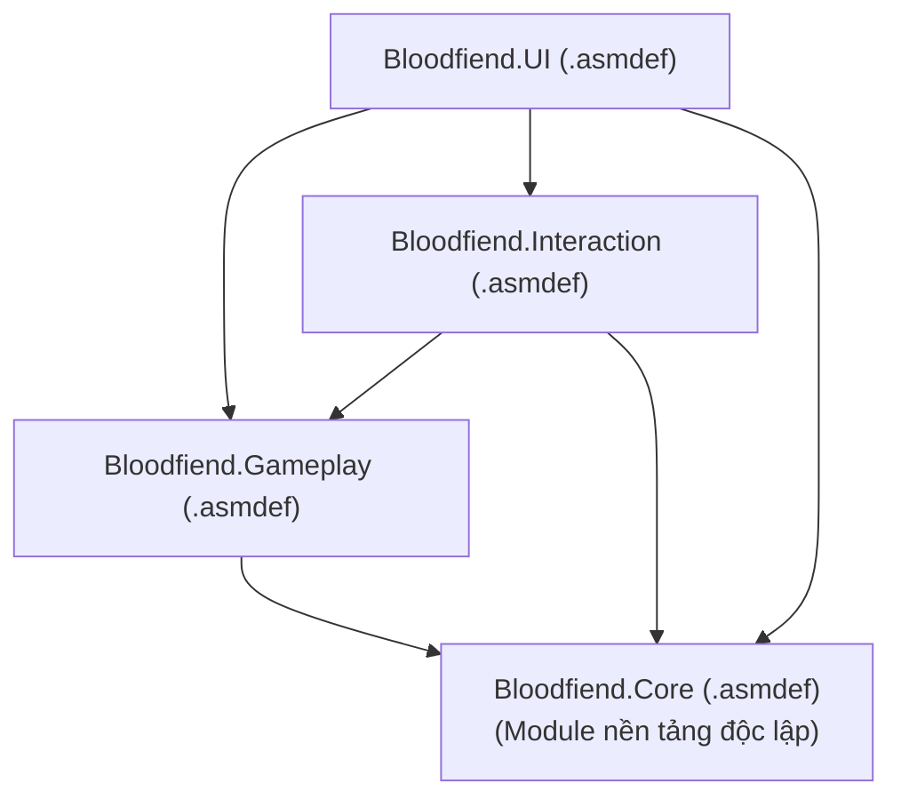

# Bloodfiend - Unity Game Client 🎮🩸

> **Thể loại:** 2D Top-down Kinh dị Sinh tồn & Giải đố Môi trường  
> **Phiên bản Unity:** Unity 6 (`6000.3.19f1 LTS`)  
> **Render Pipeline:** Universal Render Pipeline (URP 2D)  
> **Hệ thống Input:** New Input System (`com.unity.inputsystem`)  
> **Ngôn ngữ:** C# (.NET Standard 2.1 / C# 9+)

---

## 1. Dành cho Thành viên Mới tham gia Dự án

Chào mừng bạn đến với mã nguồn Client của **Bloodfiend (Huyết Quỷ)**! Thư mục này chứa toàn bộ dự án Unity của game.

Trò chơi xây dựng xoay quanh **cơ chế sinh tồn giữa Ánh sáng & Bóng tối**:
* **Quản lý Đèn pin:** Mức sáng thấp (soi đường tiết kiệm pin) vs. Mức sáng cao (làm choáng / triệt tiêu khả năng hồi máu của quái vật).
* **Âm thanh & Lén lút:** Chạy nhanh sẽ phát ra sóng âm thanh khiến các quái vật mù nhưng thính tai (*Speedster*) phát hiện và truy đuổi.
* **Tương tác môi trường:** Kéo rèm cửa sổ để tạo các vùng an toàn có ánh nắng mặt trời, khôi phục cầu chì và giải các câu đố để mở đường thoát.
* **Khám phá Biệt thự:** Màn chơi đa tầng (Tầng 1, Tầng 2, Khu nghiên cứu Tầng hầm, Sân vườn ngoài trời).

---

## 2. Cấu trúc Thư mục (`Assets/_Project`)

Để tránh việc tài nguyên tự làm bị lẫn lộn với các thư viện bên thứ 3 (TextMeshPro, Odin, DOTween...), **mọi tài nguyên do team phát triển bắt buộc phải nằm trong thư mục `Assets/_Project/`**:

```text
Assets/
├── _Project/                           # Toàn bộ code và asset do team tự làm
│   ├── Art/                            # Sprites, animations, normal maps, tilesets
│   │   ├── Animations/                 # Animation clips và controllers
│   │   ├── Environments/               # Tilesets, props, decal sàn/tường
│   │   ├── Materials/                  # Material 2D Lit, shader
│   │   ├── Sprites/                    # Nhân vật, quái vật, icon vật phẩm
│   │   └── UI/                         # Đồ họa HUD, khung viền, icon kho đồ
│   ├── Audio/                          # Nhạc nền, âm thanh môi trường, SFX
│   │   ├── Music/                      # Nhạc nền rùng rợn, ambient
│   │   └── SFX/                        # Tiếng bước chân, tiếng thở, quái gầm, súng
│   ├── Prefabs/                        # Các GameObject hoàn chỉnh gắn sẵn logic
│   │   ├── Characters/                 # Nhân vật người chơi (An), đồng đội (Phúc)
│   │   ├── Enemies/                    # Speedster, Regenerator, Bosses
│   │   ├── Interactables/              # Cửa, rèm cửa sổ, công tắc đèn, chìa khóa
│   │   ├── Puzzles/                    # Két khóa, bảng cầu chì, cửa sổ đọc note
│   │   └── UI/                         # Canvas HUD, popups, giao diện kho đồ
│   ├── Scenes/                         # Các Scene màn chơi phân theo mục đích
│   │   ├── Core/                       # Scene quản lý bền vững (Audio, GameState)
│   │   ├── Gameplay/                   # Các màn chơi chính thức trong biệt thự
│   │   └── Sandboxes/                  # Sân chơi thử nghiệm cá nhân của từng dev
│   ├── Scripts/                        # Mã nguồn C# phân theo Assembly Definition
│   │   ├── Core/                       # NoiseManager, Event Channels, Singletons
│   │   ├── Gameplay/                   # Player controller, đèn pin, combat, AI quái
│   │   ├── Interaction/                # Interface tương tác, câu đố, chìa khóa
│   │   └── UI/                         # Giao diện HUD, menu, bảng đọc tài liệu
│   └── Settings/                       # Cấu hình URP 2D Renderer, Input Actions
└── Settings/                           # Cấu hình pipeline toàn cục của Unity
```

---

## 3. Kiến trúc Module Assembly Definition (`.asmdef`)

Dự án sử dụng **Assembly Definitions** để tách code thành các module độc lập, giúp thời gian biên dịch cực nhanh và bảo vệ kiến trúc code không bị spaghetti:



* **`Bloodfiend.Core`:** Quản lý âm thanh, phát tiếng ồn, sự kiện hệ thống. Không phụ thuộc vào bất kỳ module nào khác.
* **`Bloodfiend.Gameplay`:** Điều khiển người chơi, đèn pin, thể lực, máy trạng thái của quái vật.
* **`Bloodfiend.Interaction`:** Các vật thể tương tác (cửa, rèm cửa, ngăn bàn), câu đố.
* **`Bloodfiend.UI`:** Hiển thị HUD, đọc ghi chép/nhật ký, giao diện kho đồ.

---

## 4. Bảng Phím Điều khiển Mặc định (Prototype)

| Thao tác | Phím / Chuột | Hành vi |
| :--- | :--- | :--- |
| **Di chuyển** | `W`, `A`, `S`, `D` / Phím mũi tên | Di chuyển 8 hướng góc nhìn Topdown |
| **Ngắm / Xoay người** | Con trỏ chuột | Nhân vật luôn xoay mặt hướng về chuột |
| **Chạy nhanh (Sprint)** | Giữ `Left Shift` | Tăng tốc độ, tiêu hao thể lực, phát ra tiếng động |
| **Bật / Tắt Đèn pin** | `F` | Bật hoặc Tắt đèn pin |
| **Đổi Mức Sáng** | `Q` | Chuyển đổi giữa mức sáng Thường và mức Cao |
| **Tương tác** | `E` | Mở rèm cửa, nhặt vật phẩm, mở cửa |

---

## 5. Quy tắc Vàng khi Làm việc Nhóm

1. **Không sửa chung Scene chính cùng lúc:** Mỗi người hãy tạo một scene riêng trong `Assets/_Project/Scenes/Sandboxes/<TênBạn>/` để test tính năng.
2. **Không bao giờ xóa file `.meta`:** Mọi thao tác di chuyển, đổi tên hoặc xóa asset phải làm bên trong Unity Editor.
3. **Luôn commit file `.meta` cùng với asset:** Khi commit file code hoặc hình ảnh, luôn nhớ stage cả file `.meta` đi kèm.

